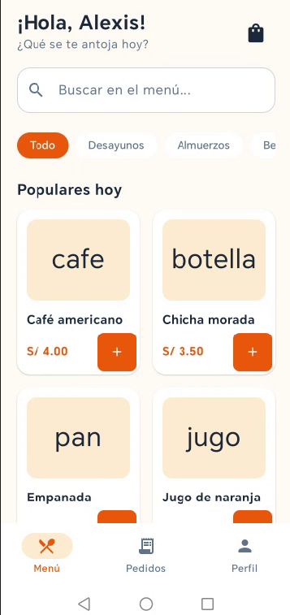
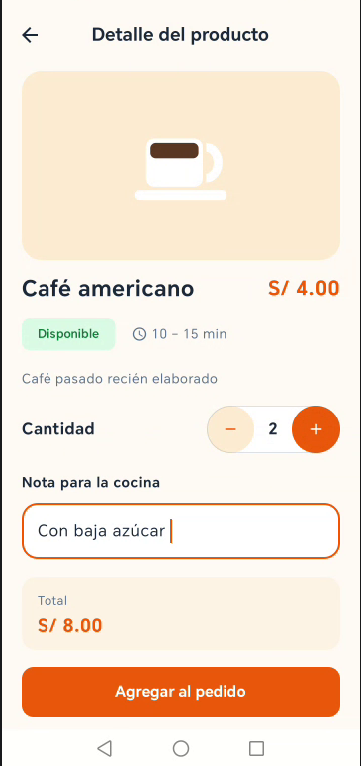
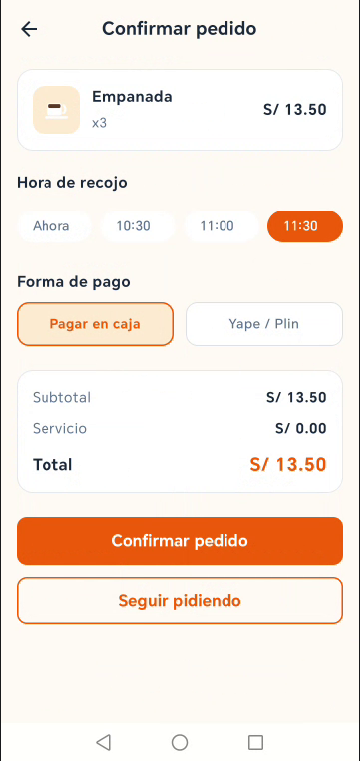
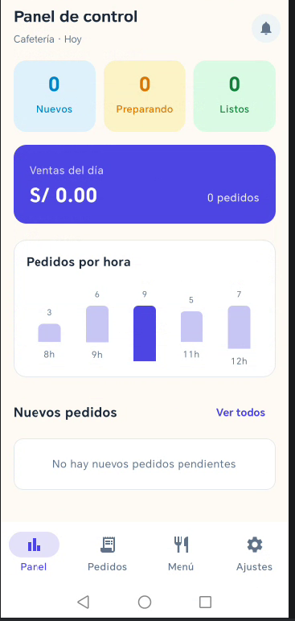
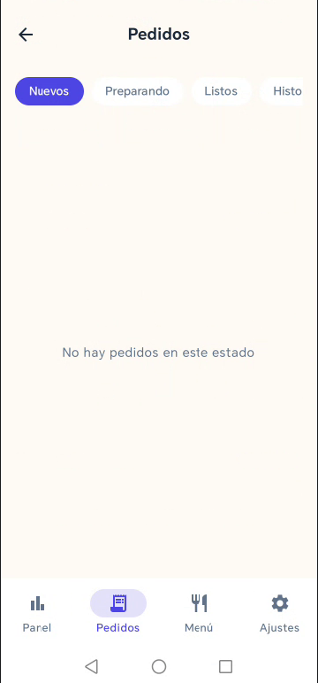
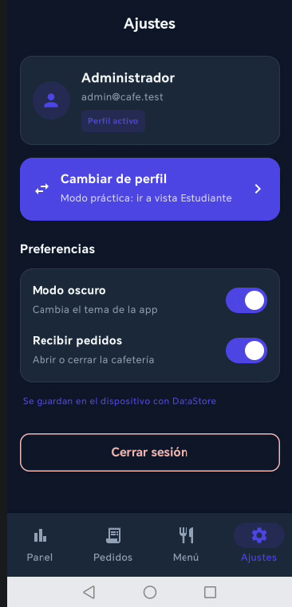

# CafeCampus 

**CafeCampus** es una aplicación móvil desarrollada en Android con Jetpack Compose para optimizar y agilizar los pedidos en las cafeterías universitarias. Permite a los estudiantes realizar pedidos por adelantado y hacer seguimiento en tiempo real, mientras que los administradores gestionan el menú, monitorean las métricas del negocio y actualizan los estados de preparación.

---

## Arquitectura y Estructura del Proyecto

El proyecto utiliza **MVVM** con `StateFlow` para la reactividad de la interfaz, **Room** para la base de datos local y **DataStore** para las preferencias.

### Diagrama MVVM

```text
+-----------------------------------------------------------------+
|                        VISTA (UI)                               |
|   (Jetpack Compose Screens, Components, Theme & Navigation)     |
+-----------------------------------------------------------------+
                                |
                   Eventos UI   |   Suscripción a Estados
                   (User Input) v   (StateFlow / CollectAsState)
+-----------------------------------------------------------------+
|                        VIEWMODEL                                |
|    (MenuViewModel, PedidosViewModel, PedidosAdminViewModel)     |
+-----------------------------------------------------------------+
                                |
                Lectura / Carga |   Actualización de Datos
                                v   (Repository Pattern)
+-----------------------------------------------------------------+
|                        MODELO / DATA                            |
|       (Room / Local Store / PreferenciasStore - DataStore)      |
+-----------------------------------------------------------------+
```

### Árbol de Paquetes y Archivos

```text
com.prieto.cafecampus
├── MainActivity.kt
├── CafeApp.kt (Inicializa Room Database y CafeRepository)
│
├── data
│   ├── local
│   │   ├── entity
│   │   │   ├── Producto.kt
│   │   │   ├── Usuario.kt
│   │   │   ├── Pedido.kt
│   │   │   └── DetallePedido.kt
│   │   ├── dao
│   │   │   ├── ProductoDao.kt
│   │   │   ├── UsuarioDao.kt
│   │   │   └── PedidoDao.kt
│   │   ├── relation
│   │   │   └── PedidoConDetalle.kt
│   │   ├── CafeDatabase.kt
│   │   └── DatosIniciales.kt
│   ├── repository
│   │   ├── CafeRepository.kt (Contrato de repositorio)
│   │   └── CafeRepositoryRoom.kt (Implementación Room)
│   └── prefs
│       └── PreferenciasStore.kt (Persistencia DataStore)
│
├── model
│   ├── Rol.kt
│   ├── EstadoPedido.kt
│   └── ItemCarrito.kt
│
├── viewmodel
│   ├── CafeViewModelFactory.kt
│   ├── MenuViewModel.kt
│   ├── SesionViewModel.kt
│   ├── PedidosClienteViewModel.kt
│   ├── PanelAdminViewModel.kt
│   ├── PedidosAdminViewModel.kt
│   └── MenuAdminViewModel.kt
│
└── ui
├── theme
│   ├── Color.kt
│   ├── Type.kt
│   └── Theme.kt
├── components
│   ├── AppTopBar.kt
│   ├── CafeButton.kt
│   ├── CafeTextField.kt
│   ├── EstadoChip.kt
│   ├── ProductoCard.kt
│   ├── ProductoIcono.kt
│   ├── PedidoCard.kt
│   └── StepperEstado.kt
├── navigation
│   ├── Rutas.kt
│   └── NavCafe.kt
├── cliente
│   ├── SplashScreen.kt
│   ├── LoginScreen.kt
│   ├── MenuScreen.kt
│   ├── DetalleProductoScreen.kt
│   ├── ConfirmarPedidoScreen.kt
│   ├── SeguimientoScreen.kt
│   └── MisPedidosScreen.kt
└── admin
├── PanelScreen.kt
├── PedidosAdminScreen.kt
├── DetallePedidoAdminScreen.kt
├── MenuAdminScreen.kt
├── FormularioProductoScreen.kt
└── AjustesAdminScreen.kt
```

---

## Pruebas de Aceptación (Fase 1)

| Prueba | Resultado Esperado | OK |
| :--- | :--- | :---: |
| **Login con clave incorrecta** | Mensaje de error, no entra a la aplicación | [x] |
| **Estudiante: agregar 2 productos y confirmar** | Pedido creado con estado *Recibido* y total correcto | [x] |
| **Producto agotado** | No se permite agregar al pedido | [x] |
| **Admin: pasar el pedido a Preparando** | El seguimiento del estudiante cambia a *Preparando* sin reiniciar | [x] |
| **Admin: cancelar un pedido** | Aparece como *Cancelado* en el historial del estudiante | [x] |
| **Admin: cambiar precio de un producto** | Los pedidos antiguos conservan su precio original | [x] |
| **Ventas del día** | Suma únicamente los pedidos no cancelados | [x] |
| **Cerrar y abrir la app** | Los pedidos se mantienen y el perfil/sesión se recuerda | [x] |
| **Rotar la pantalla** | No se pierde el carrito ni los datos ingresados | [x] |

---

## Capturas de Pantalla

### Perfil Estudiante / Cliente

|      1. Menú de Productos      |         2. Detalle del producto          |      3. Confirmar pedido y seguimiento       |
|:------------------------------:|:----------------------------------------:|:--------------------------------------------:|
|  |  |  |

### Perfil Administrador

|        1. Panel de Control         |         2. Gestión de Pedidos          |        3. Ajustes y Modo Oscuro        |
|:----------------------------------:|:--------------------------------------:|:--------------------------------------:|
|  |  |  |

---

## 🧠 Para Pensar

### 1. ¿Por qué el Repository es una interface?

> **Respuesta:** Para desacoplar la lógica de la fuente de datos, permitiendo cambiar de base local a API sin tocar el ViewModel.

### 2. ¿Por qué crearPedido es suspend y observarPedidosCliente es Flow?

> **Respuesta:** Es suspend porque es una escritura asíncrona de un solo uso; y Flow porque es un flujo continuo de datos reactivos.

### 3. ¿Qué pasaría si dos perfiles usaran bases de datos distintas?

> **Respuesta:** Que cada uno vería información diferente y las cuentas no cuadrarían; lo ideal es que ambos usen la misma base.

### 4. ¿Qué debería cambiar si mañana los datos viven en un servidor?

> **Respuesta:** Solo la capa de datos (el Repository); la UI y los ViewModels se mantienen intactos.