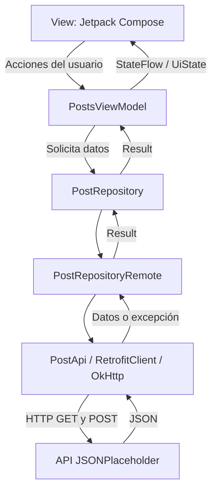
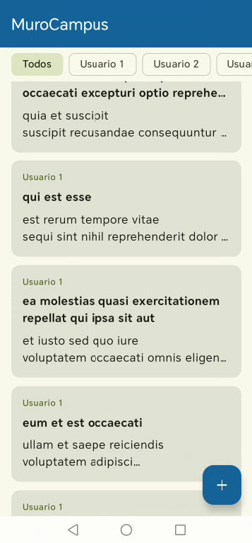
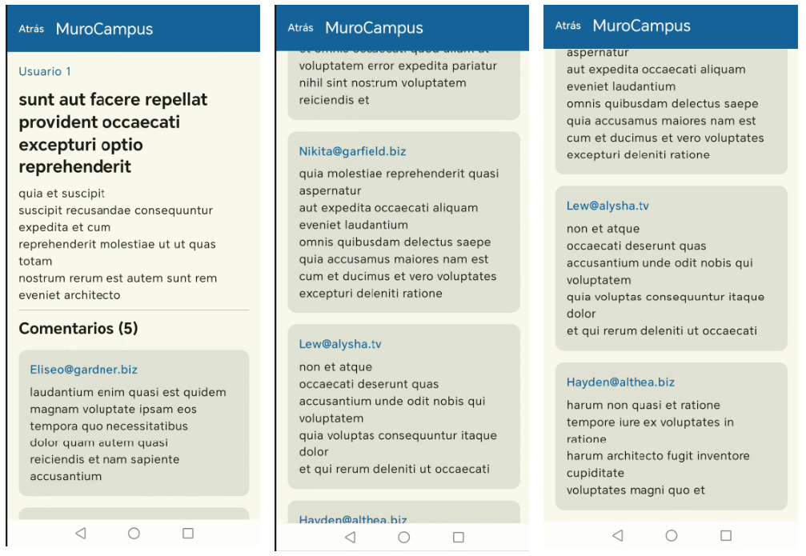
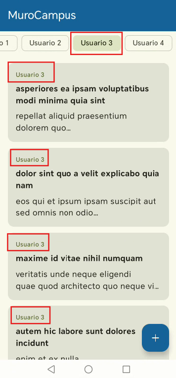
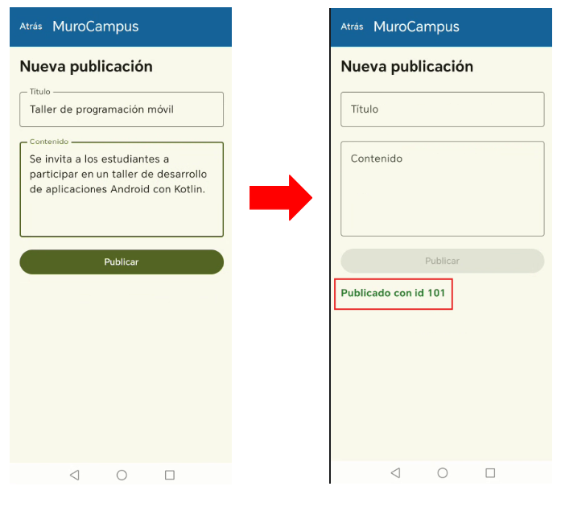
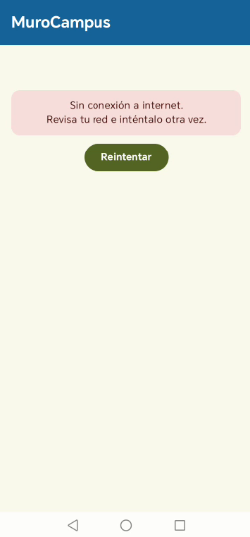

# MuroCampus – Laboratorio 09

## Alumno: Alexis Prieto Huiza

## Descripción

MuroCampus es una aplicación móvil desarrollada en Android Studio con Kotlin y Jetpack Compose. Permite consultar publicaciones y comentarios desde la API REST de JSONPlaceholder, filtrar publicaciones por usuario y simular la creación de una nueva publicación. Se utiliza la arquitectura MVVM + Repository para separar la interfaz, la lógica y el acceso a los datos.

## Funcionalidades

- Visualización de las 100 publicaciones.
- Consulta del detalle de una publicación y sus cinco comentarios.
- Filtro por usuario (del 1 al 10) y opción Todos.
- Creación de publicaciones con validación de título y contenido.
- Manejo de estados de carga, éxito y error.
- Opción de reintentar cuando falla una consulta.

## Tecnologías utilizadas

- Kotlin y Jetpack Compose
- MVVM + Repository
- Retrofit y OkHttp
- Kotlinx Serialization
- Corrutinas y StateFlow
- JSONPlaceholder

## Estructura de paquetes

```text
com.prieto.murocampus/
├── MainActivity.kt
├── model/
│   └── Modelos.kt
├── data/
│   ├── PostRepository.kt
│   ├── MensajesError.kt
│   └── remote/
│       ├── PostApi.kt
│       └── RetrofitClient.kt
├── viewmodel/
│   ├── PostsViewModel.kt
│   ├── PostsViewModelFactory.kt
│   └── UiState.kt
└── ui/
    ├── Componentes.kt
    ├── PantallaLista.kt
    ├── PantallaDetalle.kt
    ├── PantallaCrear.kt
    └── theme/
        ├── Color.kt
        ├── Theme.kt
        └── Type.kt
```

## Arquitectura MVVM + Repository



La interfaz observa los estados del ViewModel y envía las acciones del usuario. El ViewModel solicita los datos mediante la interface PostRepository. La implementación del Repository se comunica con el servicio web y devuelve un Result para controlar los errores.

## Servicio web

URL base: https://jsonplaceholder.typicode.com/

| Método | Endpoint | Función |
|---|---|---|
| GET | `/posts` | Listar publicaciones |
| GET | `/posts/{id}` | Consultar una publicación |
| GET | `/posts/{id}/comments` | Consultar comentarios |
| GET | `/posts?userId=2` | Filtrar por usuario (ejemplo) |
| POST | `/posts` | Crear una publicación simulada |

JSONPlaceholder simula la creación de publicaciones y devuelve el ID 101, pero no guarda los nuevos datos de forma permanente.

## Capturas de funcionamiento

### 1. Lista de publicaciones



### 2. Detalle y comentarios



### 3. Filtro por usuario



### 4. Creación de una publicación



### 5. Error de conexión



## Pruebas realizadas

| Prueba | Resultado |
|---|---|
| Sin internet | Se muestra el mensaje de error con el botón Reintentar. |
| Reintentar | Se recupera la lista al restablecer la conexión. |
| Recurso inexistente | Se muestra Error del servidor (404). |
| JSON inesperado | Se ignoran los campos desconocidos y se muestra un error si falta un campo obligatorio. |
| Cancelación | Se puede regresar rápidamente desde el detalle sin que la aplicación se cierre. |
| Lista y detalle | Se visualizan las publicaciones y sus cinco comentarios. |
| Filtro | Se muestran diez publicaciones por usuario y cien al seleccionar Todos. |
| Crear publicación | Se obtiene HTTP 201 y se muestra Publicado con id 101. |
| Revisión del código | El paquete viewmodel no utiliza Retrofit, PostApi ni HttpException directamente. |

## Para pensar

### 1. ¿Qué diferencia hay entre GET y POST? ¿Por qué crear lleva @Body y porUsuario lleva @Query?

GET se utiliza para consultar información del servidor, mientras que POST permite enviar información para crear un recurso. En el proyecto usamos @Body para enviar los datos de una nueva publicación en formato JSON y @Query para indicar el usuario por el que queremos filtrar las publicaciones.

### 2. ¿Por qué la ruta es "posts" y no "/posts"?

Porque "posts" es una ruta relativa que se agrega a la URL base de Retrofit. Si usamos "/posts", la ruta comienza desde la raíz del servidor y puede ignorar una parte de la URL base si esta contiene una ruta adicional. En este proyecto ambas apuntarían al mismo recurso, pero se utiliza la ruta relativa como buena práctica.

### 3. ¿Por qué el Repository devuelve Result en vez de dejar que la excepción llegue al ViewModel?

Porque permite manejar los resultados exitosos y los errores de manera ordenada. Así el ViewModel puede utilizar onSuccess y onFailure para actualizar el estado de la pantalla sin tener que controlar directamente las excepciones de la red. Las excepciones de cancelación se vuelven a lanzar para respetar el funcionamiento de las corrutinas.

### 4. ¿Qué pasa si olvidas el permiso INTERNET? ¿Y si olvidas ignoreUnknownKeys y el servidor agrega un campo nuevo?

Sin el permiso INTERNET, la aplicación no puede realizar las peticiones al servicio web. Si no configuramos ignoreUnknownKeys, un campo adicional que no esté definido en el modelo puede provocar un error al convertir el JSON en objetos Kotlin.

### 5. ¿Por qué la pantalla de lista usa un when sobre UiState y no un if con tres variables?

Porque UiState permite representar un solo estado a la vez: Cargando, Exito o Error. Con when podemos mostrar lo que corresponde a cada estado y evitar contradicciones, como mostrar un mensaje de error y un indicador de carga al mismo tiempo.

### 6. JSONPlaceholder no guarda los POST. ¿Cómo cambiaría tu app si usaras un servicio real?

Con un servicio real, la publicación se guardaría en el servidor y tendría un identificador propio. Después de recibir una respuesta exitosa, actualizaría la lista o volvería a consultarla para mostrar la nueva publicación. También se podrían incorporar mecanismos de autenticación según los requisitos del servicio.
