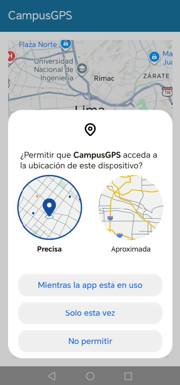
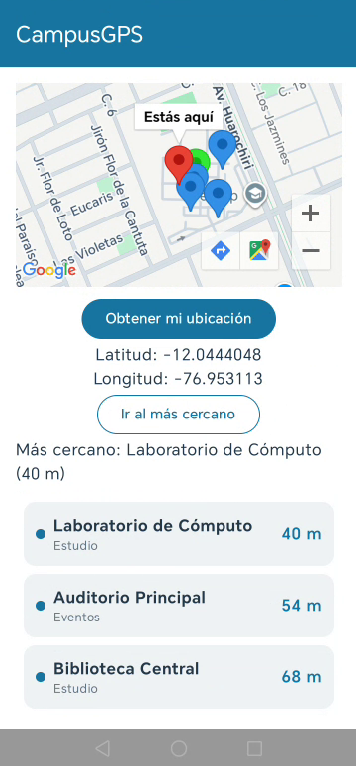
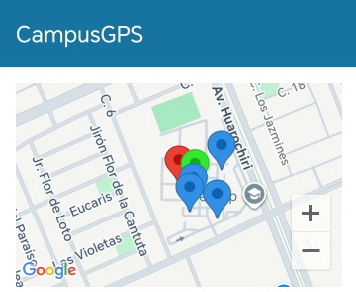
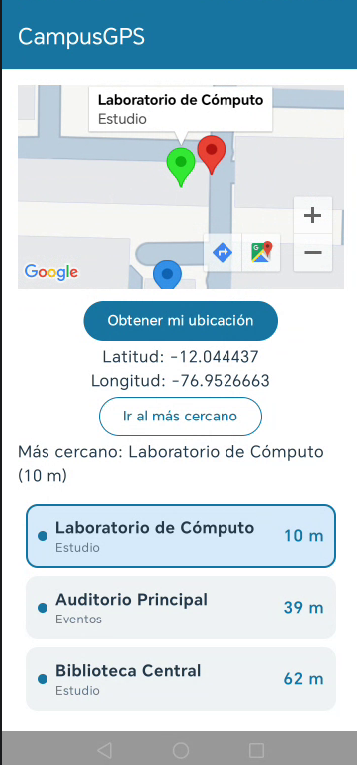
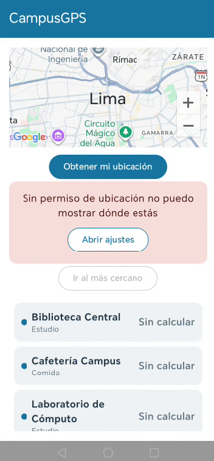

# CampusGPS

## Descripción

CampusGPS es una aplicación Android desarrollada con Kotlin y Jetpack Compose para mostrar la ubicación actual del usuario y cinco lugares de un campus en Google Maps.

La aplicación permite solicitar permisos de ubicación, mostrar marcadores, calcular y ordenar las distancias hacia los lugares, seleccionar destinos e identificar el más cercano. También maneja errores relacionados con permisos, ubicación no disponible y Google Play Services.

El proyecto utiliza la arquitectura MVVM + Repository.

## Tecnologías utilizadas

- Kotlin
- Jetpack Compose
- Material 3
- Google Maps SDK for Android
- Maps Compose
- FusedLocationProviderClient
- Kotlin Coroutines
- StateFlow
- Android Studio

## Estructura de paquetes

```text
com.prieto.campusgps/
├── MainActivity.kt
├── model/
│   └── Modelos.kt
├── data/
│   ├── UbicacionRepository.kt
│   ├── UbicacionRepositoryGoogle.kt
│   ├── LugaresRepository.kt
│   └── LugaresRepositoryLocal.kt
├── util/
│   ├── Distancia.kt
│   └── Formato.kt
├── viewmodel/
│   ├── MapaViewModel.kt
│   └── CampusViewModelFactory.kt
└── ui/
    ├── PantallaMapa.kt
    ├── MapaUbicacion.kt
    ├── ListaLugares.kt
    ├── MensajeError.kt
    └── theme/
```

## Arquitectura MVVM + Repository

```text
View (Jetpack Compose)
PantallaMapa / MapaUbicacion / ListaLugares
             |
             | Eventos del usuario
             v
ViewModel (MapaViewModel)
             |
             | Llama a interfaces
             v
       Repositories
             |
       +-----+------+
       |            |
       v            v
UbicacionRepo   LugaresRepo
Google          Local
       |            |
       v            v
FusedLocation    Lista de
ProviderClient   cinco lugares

El ViewModel publica StateFlow.
La View observa los estados con collectAsState().
```

La View se encarga de mostrar la interfaz. El ViewModel administra los estados y coordina las operaciones. Los Repositories proporcionan los datos de ubicación y de lugares.

El cálculo de distancias se realiza mediante una función de `util/Distancia.kt`, que utiliza `Location.distanceBetween()`.

## Lugares del campus

La aplicación utiliza cinco lugares de prueba:

1. Biblioteca Central — Estudio
2. Cafetería Campus — Comida
3. Laboratorio de Cómputo — Estudio
4. Auditorio Principal — Eventos
5. Estacionamiento Norte — Servicios

## Funcionalidades

- Solicitar permisos de ubicación en tiempo de ejecución.
- Obtener la latitud y longitud del celular.
- Mostrar Google Maps y los marcadores del campus.
- Calcular distancias desde la ubicación actual.
- Ordenar los lugares de menor a mayor distancia.
- Seleccionar un lugar desde la lista.
- Mover la cámara hacia el lugar seleccionado.
- Identificar el lugar más cercano con un marcador verde.
- Manejar permiso denegado, GPS apagado o ubicación no disponible y ausencia de Google Play Services.

## Capturas de pantalla

### 1. Solicitud de permiso de ubicación



### 2. Mapa con ubicación actual



### 3. Marcadores del campus



### 4. Lista de lugares ordenada por distancia



### 5. Manejo de errores



## Configuración de Google Maps

La aplicación requiere una API Key de Google Maps con Maps SDK for Android habilitado.

La clave se configura en `local.properties`:

```properties
MAPS_API_KEY=CLAVE_API
```

## Para pensar (Preguntas)

### 1. ¿Por qué FusedLocationProviderClient está dentro del Repository y no en el ViewModel?

Porque el Repository se encarga de obtener los datos de ubicación. Así, el ViewModel solo utiliza la interfaz `UbicacionRepository`, sin depender directamente de Google Play Services ni del Context. Esto permite mantener separadas las responsabilidades.

### 2. ¿Qué diferencia hay entre el permiso de ubicación y la clave de API de Maps? ¿Qué pasa si falta cada uno?

El permiso de ubicación permite que la aplicación acceda a la posición del celular. La clave de API autoriza el uso de Google Maps. Si falta el permiso, no se puede obtener la ubicación del usuario. Si falta una clave válida, el mapa puede aparecer vacío o gris aunque la aplicación tenga permiso de ubicación.

### 3. ¿Por qué la clave va en local.properties y no en el código? ¿Qué harías si se subiera a GitHub por error?

Se utiliza `local.properties` para evitar guardar directamente la clave dentro del código fuente y subirla por accidente al repositorio. Si se publicara, la restringiría o revocaría desde Google Cloud, generaría una nueva clave y revisaría el historial del repositorio para eliminar la información expuesta.

### 4. ¿Dónde calculas la distancia y por qué no en el Composable?

La distancia se calcula mediante `distanciaMetros()` en `util/Distancia.kt` y se utiliza desde `MapaViewModel.kt`. No se calcula en el Composable porque la interfaz solo debe mostrar los datos y responder a las acciones del usuario. De esta manera se respeta la arquitectura MVVM.

### 5. ¿Qué pasa con tu app si el usuario niega el permiso dos veces? ¿Cómo lo manejas?

La aplicación muestra un mensaje indicando que no tiene permiso para acceder a la ubicación y ofrece el botón "Abrir ajustes". El usuario puede habilitar el permiso desde la configuración de Android. La aplicación no se cierra y permite volver a intentar obtener la ubicación.


