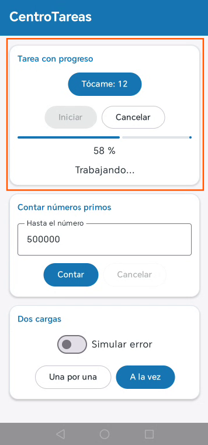
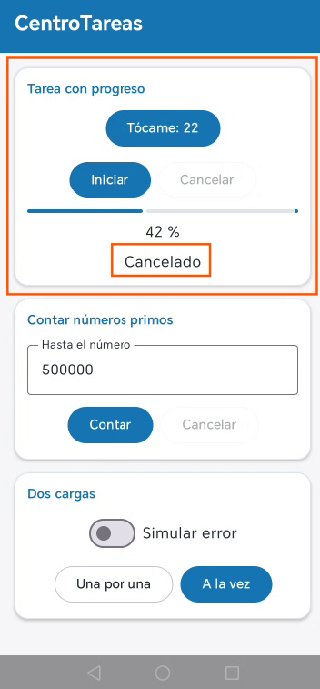
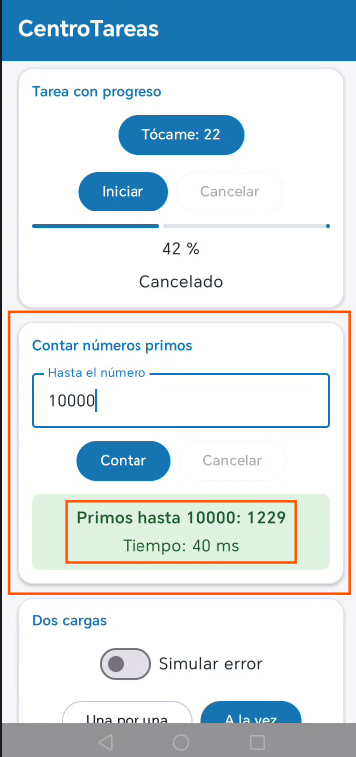
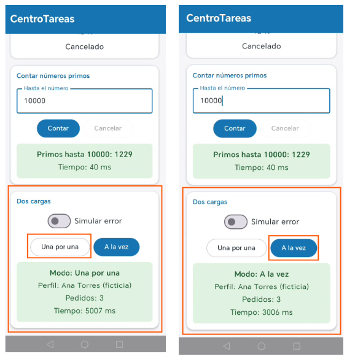
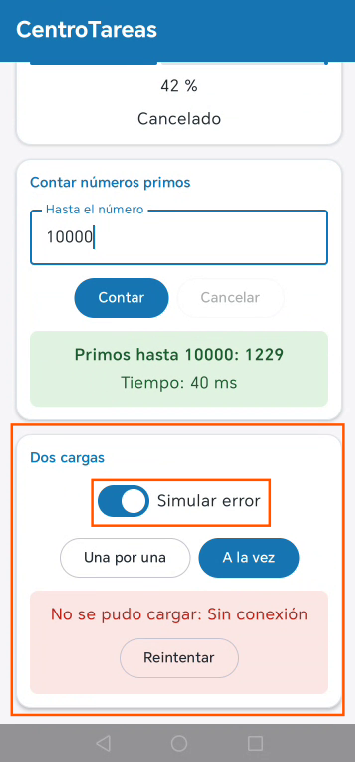
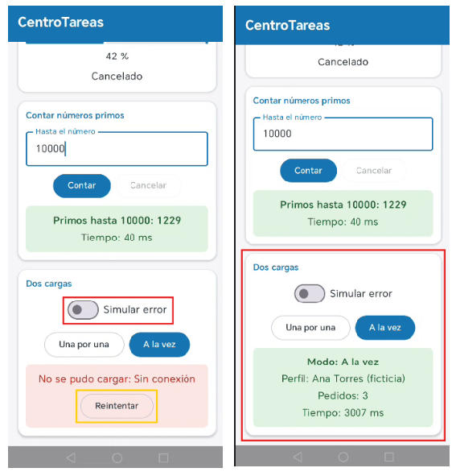

# CentroTareas — Hilos en Android

## Descripción

**CentroTareas** es una aplicación Android desarrollada con **Kotlin, Jetpack Compose y Material 3** para demostrar cómo ejecutar tareas de larga duración sin congelar la interfaz. Utiliza corrutinas, `viewModelScope`, `StateFlow` y una arquitectura **MVVM + Repository**.

La aplicación contiene tres tarjetas:

1. **Tarea con progreso:** barra de 0 a 100 % en aproximadamente 4 segundos, contador «Tócame», protección frente al doble inicio y cancelación mediante `Job`.
2. **Contar números primos:** calcula primos hasta un número N en `Dispatchers.Default`, mide la duración y permite cancelar el cálculo con `ensureActive()`.
3. **Dos cargas:** compara la carga secuencial (aproximadamente 5 s) con la paralela (aproximadamente 3 s) y simula un error de conexión para permitir reintentar.

Los datos de perfil y pedidos son **ficticios**. Las cargas se simulan con `delay()` y no requieren internet.

## Tecnologías

- Kotlin y Jetpack Compose (Material 3), sin XML para la pantalla.
- Corrutinas: `launch`, `async`, `coroutineScope`, `await`, `withContext`, `delay` y `CancellationException`.
- `viewModelScope`, `StateFlow`, `Job`.
- Patrón MVVM + Repository (interfaz).

## Estructura de paquetes

```text
com.prieto.centrotareas/
├── MainActivity.kt
├── model/
│   └── Estados.kt
├── data/
│   ├── TareasRepository.kt
│   └── TareasRepositoryLocal.kt
├── viewmodel/
│   ├── TareasViewModel.kt
│   └── TareasViewModelFactory.kt
└── ui/
    ├── PantallaTareas.kt
    └── theme/
        ├── Color.kt
        ├── Theme.kt
        └── Type.kt
```

> En este proyecto se utiliza el paquete `com.prieto.centrotareas`.

## Diagrama MVVM + Repository

```text
Usuario
  |
  v
PantallaTareas.kt (View: botones y estados)
  | eventos                  ^ collectAsState()
  v                          |
TareasViewModel.kt ----- StateFlow
  | viewModelScope / corrutinas
  v
TareasRepository.kt (interface)
  |
  v
TareasRepositoryLocal.kt
  ├── cargarPerfil(): delay(2000)
  ├── cargarPedidos(): delay(3000)
  └── contarPrimos(): Dispatchers.Default + ensureActive()
```

La **View** muestra el estado y comunica eventos; el **ViewModel** gestiona estados y trabajos; el **Repository** ejecuta las operaciones sin depender de la interfaz.

## Observación del Paso 1: bloqueo del hilo principal

En la primera prueba, el botón «Tarea larga (MAL)» llamaba a `Thread.sleep(4000)` directamente en el hilo principal. Durante aproximadamente cuatro segundos, la aplicación no respondía visualmente. Al presionar varias veces «Tócame» durante el bloqueo, el contador no aumentaba de inmediato; se actualizaba de golpe al terminar la espera.

El mensaje «Trabajando...» no se veía durante esos cuatro segundos porque Android no podía actualizar la interfaz mientras el hilo principal estaba bloqueado. Con una espera de 10 segundos, Android podría mostrar el cuadro **La aplicación no responde** (ANR).

En el paso siguiente se reemplazó ese bloqueo por una corrutina con `viewModelScope.launch`, `withContext(Dispatchers.Default)` y `delay(4000)`, de forma que los toques siguieran respondiendo.

## Capturas de pantalla

**1. Tarea con progreso (pendiente de captura)**



**2. Tarea cancelada (barra detenida en 94 %)**



**3. Números primos y tiempo de cálculo**



**4. Comparación: una por una frente a a la vez**



**5. Estado de error y botón Reintentar**



*Evidencia adicional: resultado exitoso después del reintento.*



## Para pensar

**1. ¿Por qué no se veía «Trabajando...» en el Paso 1?**

Porque `Thread.sleep(4000)` bloqueaba el hilo principal. Aunque se cambiaba el valor del mensaje, Android no podía redibujar la pantalla hasta que terminara ese bloqueo.

**2. ¿Qué diferencia hay entre `Thread.sleep` y `delay`?**

`Thread.sleep` bloquea el hilo durante la espera, impidiendo que realice otras tareas. `delay` suspende la corrutina sin bloquear el hilo y permite que se atiendan otras operaciones; además, la espera se puede cancelar.

**3. ¿Por qué `Dispatchers.Default` para los primos y `Dispatchers.IO` para la red?**

Contar primos requiere principalmente procesamiento del CPU, por lo que corresponde a `Dispatchers.Default`. Las operaciones bloqueantes de entrada y salida, como ciertas llamadas de red o disco, se realizan generalmente en `Dispatchers.IO`. Las cargas de este laboratorio son simuladas con `delay()` y no hacen solicitudes de red reales.

**4. ¿Qué pasaría con la corrutina si el usuario cierra la pantalla? ¿Qué papel cumple `viewModelScope`?**

Si se destruye definitivamente el ViewModel, `viewModelScope` cancela las corrutinas asociadas y evita que sigan trabajando sin la pantalla. En cambio, durante una rotación normal de pantalla el ViewModel puede conservarse, por lo que la tarea y su progreso continúan.

**5. ¿Por qué `async` tarda 3 s y no 5 s? ¿Qué pasa si una de las dos cargas falla?**

Las cargas de perfil (2 s) y pedidos (3 s) comienzan al mismo tiempo, por lo que la duración total se aproxima a la mayor de ambas: 3 segundos. Si una carga falla, `coroutineScope` propaga el fallo y cancela las tareas hermanas que sigan activas. El ViewModel captura las excepciones normales y muestra un error en pantalla; si la excepción corresponde a cancelación, debe relanzarla.


