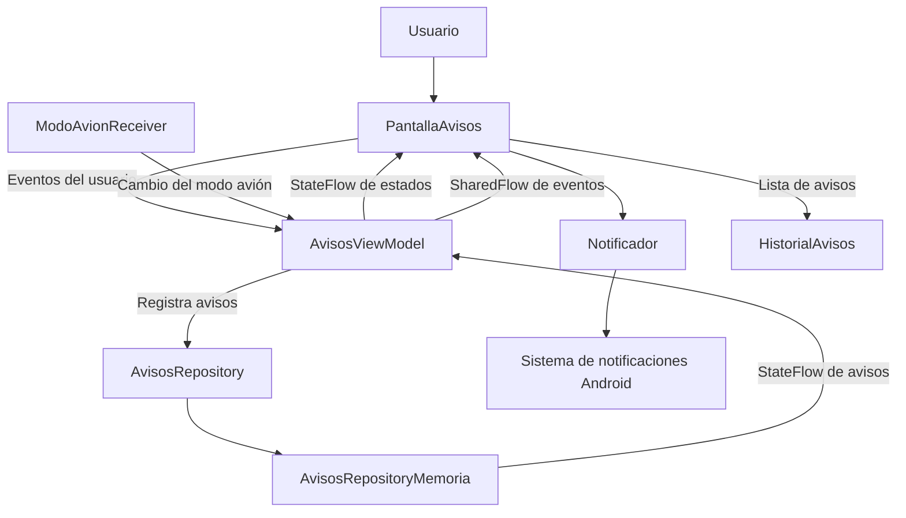
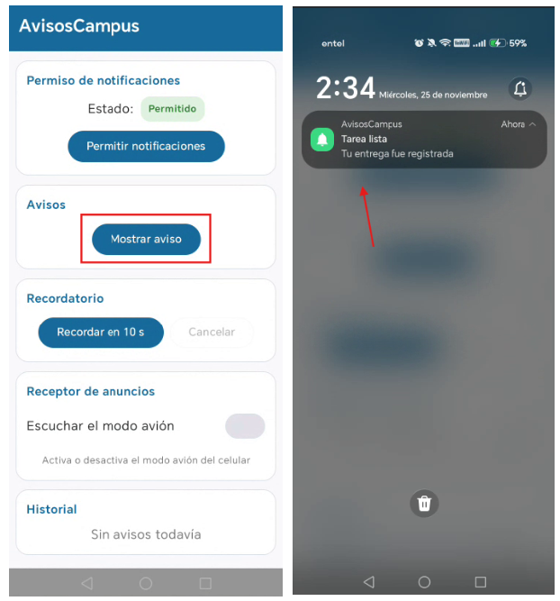
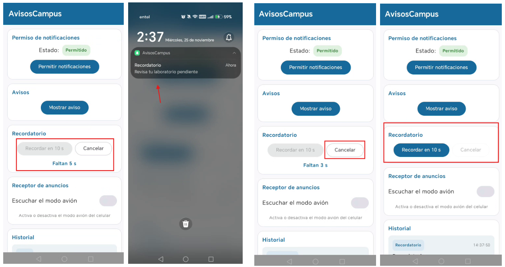
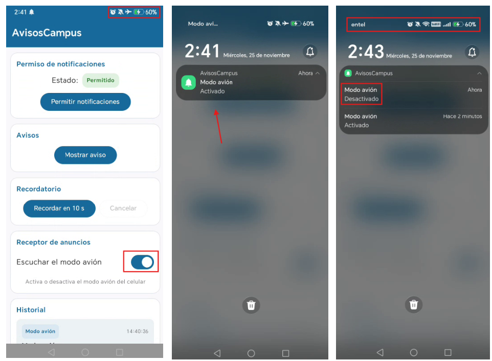
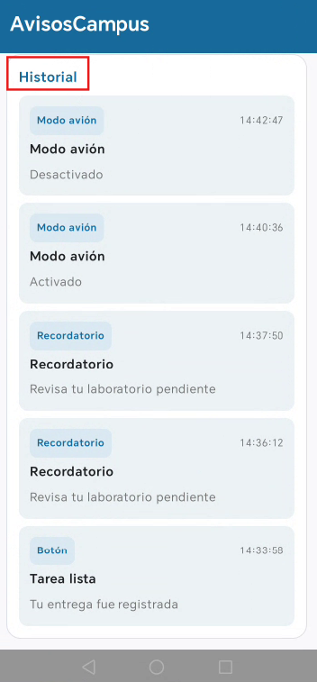
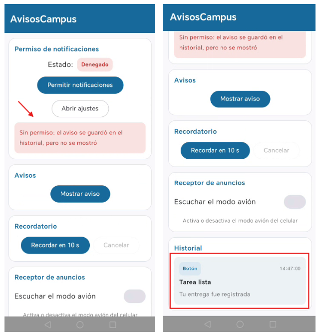

# AvisosCampus — Laboratorio 15

## Alumno: Alexis Prieto Huiza

## Descripción

AvisosCampus es una aplicación móvil desarrollada en Kotlin que permite mostrar notificaciones locales, programar recordatorios de 10 segundos y detectar los cambios del modo avión del celular. También cuenta con un historial donde se registran los avisos generados y un manejo del permiso de notificaciones para evitar errores cuando el usuario no lo concede.

## Tecnologías utilizadas

- Kotlin
- Jetpack Compose
- Material 3
- Arquitectura MVVM + Repository
- Corrutinas
- StateFlow y SharedFlow
- NotificationCompat
- PendingIntent
- BroadcastReceiver

## Funcionalidades

- Creación del canal de notificaciones Avisos.
- Solicitud del permiso de notificaciones.
- Visualización del estado del permiso.
- Generación de notificaciones locales.
- Apertura de la aplicación al tocar una notificación.
- Recordatorio de 10 segundos con cancelación.
- Detección de los cambios del modo avión.
- Historial de los 20 avisos más recientes.
- Manejo del permiso denegado y acceso a los ajustes.

## Estructura de paquetes

```text
com.prieto.avisoscampus/
├── AvisosApp.kt
├── MainActivity.kt
├── model/
│   └── Modelos.kt
├── data/
│   └── AvisosRepository.kt
├── notificacion/
│   └── Notificador.kt
├── receiver/
│   └── ModoAvionReceiver.kt
├── viewmodel/
│   ├── AvisosViewModel.kt
│   └── AvisosViewModelFactory.kt
└── ui/
    ├── PantallaAvisos.kt
    ├── HistorialAvisos.kt
    └── theme/
        ├── Color.kt
        ├── Theme.kt
        └── Type.kt
```

## Arquitectura MVVM + Repository



La arquitectura MVVM permite separar la interfaz de la lógica de la aplicación. El ViewModel administra los estados y decide qué avisos generar, mientras que el Repository registra los datos en memoria. La pantalla recibe los eventos del ViewModel y utiliza el Notificador para mostrar las notificaciones de Android.

## Capturas de pantalla

### 1. Notificación en el panel

Al pulsar el botón Mostrar aviso, se genera una notificación local con el título Tarea lista.



### 2. Recordatorio

La aplicación realiza una cuenta regresiva de 10 segundos y permite cancelar el recordatorio antes de finalizar.



### 3. Receptor del modo avión

Al activar el receptor, la aplicación detecta los cambios del modo avión y genera las notificaciones correspondientes.



### 4. Historial de avisos

Se muestran los últimos avisos generados, incluyendo su origen, título, descripción y hora.



### 5. Permiso denegado

Cuando el permiso está denegado, la aplicación muestra un mensaje de error y conserva el aviso en el historial. También permite acceder a los ajustes para habilitar las notificaciones.



## Para pensar

### 1. ¿Por qué una notificación necesita un canal y un permiso? ¿Qué pasa si falta cada uno?

El canal permite organizar las notificaciones y controlar su comportamiento. Desde Android 8 es necesario tener un canal para mostrarlas. El permiso permite que el usuario decida si desea recibir notificaciones y es obligatorio desde Android 13. Si falta el canal requerido o el permiso no está concedido, la notificación no se mostrará.

### 2. ¿Por qué el ViewModel emite un evento y no muestra la notificación él mismo?

Porque el ViewModel se encarga de la lógica y los estados de la aplicación, mientras que la pantalla tiene acceso al Context necesario para interactuar con Android. De esta manera se mantiene la separación de responsabilidades y se respeta la arquitectura MVVM.

### 3. ¿Qué pasa si usas el mismo id en dos notificaciones?

La segunda notificación reemplaza o actualiza a la primera. Por eso se utiliza un identificador diferente para cada aviso y así se pueden mostrar varias notificaciones independientes.

### 4. ¿Por qué onReceive debe ser corto y por qué hay que quitar el receptor al salir?

Porque onReceive normalmente se ejecuta en el hilo principal y una operación pesada podría bloquear la aplicación. También es necesario quitar el receptor cuando ya no se utiliza para evitar fugas de memoria y que siga recibiendo anuncios innecesariamente.

### 5. ¿En qué casos usarías una notificación local y en cuáles una push de Firebase?

Utilizaría una notificación local para recordatorios o eventos que ocurren dentro del dispositivo. En cambio, utilizaría una notificación push de Firebase para recibir información enviada desde un servidor, como mensajes nuevos, actualizaciones o avisos importantes.

